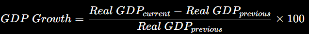
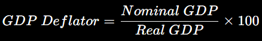
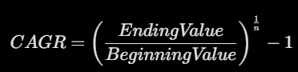

## **Q1. (Related terms)**
#### **First: What is GDP?**
GDP is the market value of all final goods and services produced withing a country's borders during a particular period, Usually one Year.

suppose an economy produces:
> Cars, Foods, software, banking services, construction, transportation, education services

The market value of those final goods and services gets added together. **_That's GDP_**

## 1. **GDP (current US$/LCU) --Nominal GDP**

Nominal GDP measures GDP using today's price tags, "Current" means unadjusted for inflation.

we better understand with examples:
> Suppose India produces 100 smartphones on year 1 with price ₹20,000 each. Then **GDP** = 100 x 20,000 = ₹20,00,000 Next year: still 100 smartphones but price rises to ₹22,000 each due to inflation. Now **GDP** = 100 x 22,000  = ₹22,00,000 GDP increased by 10%. But did production increase? **No.** We produced exactly the same number of smartphones. The increase came from **higher prices**. That's the fundamental problem with nominal GDP. And that's where Real GDP comes in.

## 2. **GDP (constant US$/LCU) -Real GDP**

Real GDP measures economic production after **removing** the effect of price changes.

That means: Real GDP tries to tell us how much the economy actually produced, rather than simply how much those things were worth at today's prices.

let's take the same example:
> Year 1: 100 phones x ₹20,000 **GDP** = ₹20 lakh Year 2: 100 phones x ₹22,000 **GDP** = ₹22 lakh Nominal GDP increased by 22 - 20 / 20 x 100 = 10% Looks impressive But prdouction stays the same both year 100 units So nominal GDP tells us: **"Economic value increased 10%"** Real GDP tells us:**"Actual production didn't increase."**

**Real GDP vs Nominal GDP**
| | **Nominal GDP** | **Real GDP** |
|--|----------------|--------|
| Prices | Current Prices | Constant/reference prices |
| Inflation effect | Included | Removed/adjusted |
| Measure | Value of production | Volume of production |
| Useful for | Current economic value | Economic growth |
| Main question | "How much is production worth?" | "How much did production actually increase?"

## 3. **GDP Growth (annual %)**

GDP growth rate tell us how much a country's real economic outpu increased or decreased compared with the provious year.

**GDP growth** = speed at which the economy is exapanding or contracting.

**Formula**

Suppose:

2023 Real GDP = ₹200 lakh crore

2024 Real GDP = ₹210 lakh crore

210 - 200 / 200 x 100 = 5%

So GDP growth = 5%

**Why does it exist?**
Because simply knowing the size of an economy isn't enough.

Imagine: **India A: GDP** = $4 trillion, growth = 2% and **India B: GDP** = $3.5 trillion, growth = 7% 

The first tells us **size**, but second tells us **speed**. And that's why analysts look at both GDP and GDP growth.

## 4. **GDP per capita**

GDP per capita simply asks:
> "How much GDP is there per person?"

**Formula**

Suppose:

**GDP** = $2 trillion and **Population** = 1 billion, then

**GDP per capita** = 2,000,000,000,000 / 1,000,000,000 = $2,000

So **GDP per capita** = **$2,000 per person**

**Why does it exist?** Because total GDP can be misleading when comparing countries or periods with different populations.

Imagine: **Country A GDP** = $1 trillion and **Population** = 100 million **AND** **Country B GDP** = $1.5 trillion and **Population** = 300 million

By seeing **Country B** has the larger economy. But **Country A** 1T/100M = $10,000 whereas **Country B** 1.5T/300M = $5,000

So Country B's total economy is larger, but GDP per person is lower.

## 5. **GDP, PPP - Purchasing Power Parity**

This is probably the most conceptually confusing one. Let's make it intuitive.

Suppose we have:

₹100 in India, and $1 in the USA. At the market lexchange rate, these may not represent _equivalent purchasing power_. Why?

Because _Prices differ between countries_. For example, imagine a simplified situation:

A certain baseket of everyday goods costs: India -> ₹100 , USA -> $5. If we used the ordinary exchange rate, we might conclude that ₹100 and $1 are equivalent. 

But if the actual basket costs $5 in America, then ₹100 gives use purchasing power more comparable to $5 in this simplified example.

PPP tries to account for these **price-level differences between countries**

**Simple definition**

GDP at PPP adjusts a country's GDP to reflect differences in the purchasing power of currencies across countries.

In simple language:
> **It asks**: "How much can this country's money actually buy compared with money in other countries?"

**Market exchange rate vs PPP**

Think of two different quesions.

_Market exchange rate_
> "How much foreign currency can I get in the financial market?"

_PPP_
> "How much purchasing power does my currency actually have inside the economy?"

That's why PPP is especally useful for comparing economic output and living standards across countries.

But PPP GDP is not simply India's GDP coverted using today's rupee-dollar exchange rate.

## 6. **Inflation, GDP Deflator**

This is the one that connects several of the previous concepts together.

_Simple Definition_: 
The GDP deflator measures the overall change in prices of goods and services produced within an economy.

It helps us understand:
> How much of the change in nominal GDP is due to changing prices rather than changing production?

**The core relationship**

_Nominal GDP_ = Current prices x current production

_Real GDP_ = constant/reference prices x current production

The GDP deflator compares the two.

Conceptually:

Suppose:

Nominal GDP = ₹220 lakh crore

Real GDP = ₹200 lakh crore

Then: 
> **_GDP Deflator_** = 220/200 x 100 = 110

A deflator of 110 means the overall price level represented by GDP is **10% higher than the reference/base level.**

## 7. **CAGR (Compound Annual Growth Rate)**

**CAGR** is a mathematical tool used to measure the smooth, average growth of an investment or dataset over mulitple years.

In reality, year-over-year growth is highly volatile—a metric might jump 30% one year and drop 10% the next. CAGR compeletely ignores the bumpy ride in the middle. It calculates the single, steady percentage rate that would logically take us from our starting point to our ending point.

**The Formula**

- _n_ = Number of years between the beginning and ending values.

### **Compound Growth of real GDP**
When we calculate the CAGR of **Real GDP**, we are mathematically stripping away two massive layers of noise from our dataset to find the true underlying trend of an economy.

- **Layer 1(Inflation):** By using Real GDP(Constant prices), we have already removed the illusion of growth caused simply by rising prices.

- **Layer 2(Volatility):** By applying CAGR, we are smoothing out the chaotic boom-and-bust economic cycles -- like the 2008 financial crisis or the 2020 pandemic -- that make year-over-year data too jagged for reliable forecasting.
