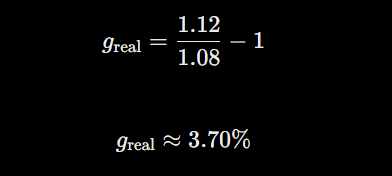
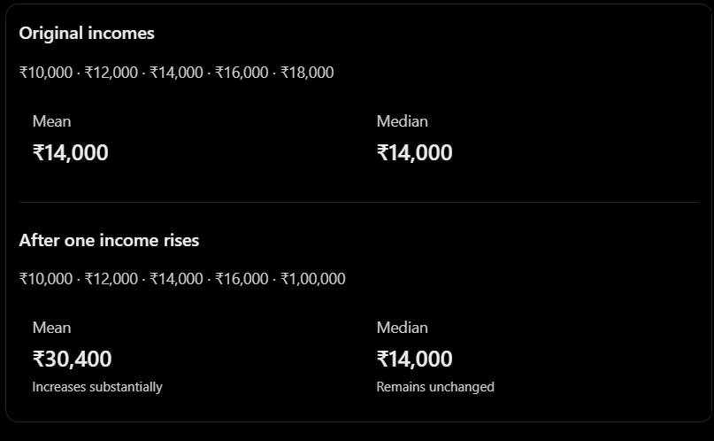
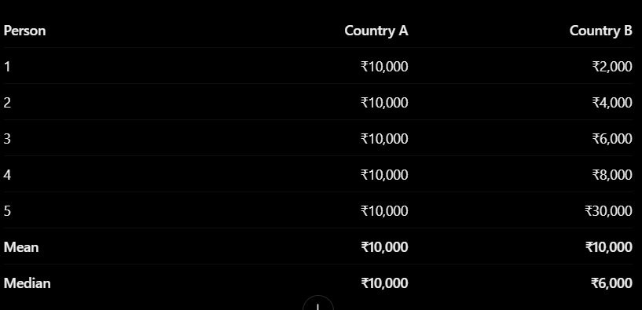
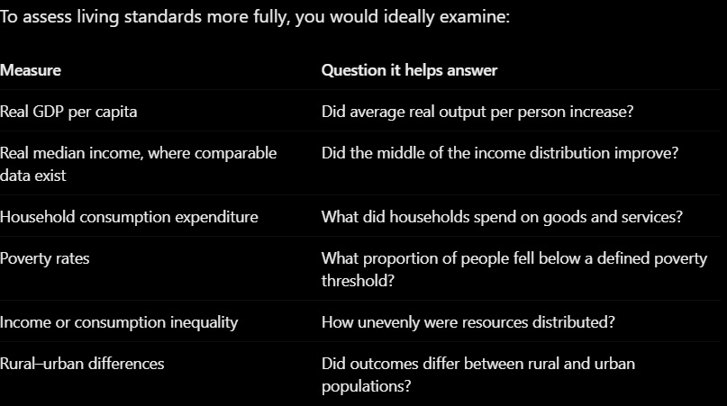

## **Dimension 2 (related terms)**

### **1. GDP per capita vs. GNI per capita**

These are our first four essential terms.
- **GDP (Gross Domestic Product):** The value of final goods and services produced within India's domestic economy during a given period.

- **GDP per capita:** GDP divided by the population.

- **GNI (Gross National Income):** GDP plus net primary income received from abroad by Indian residents.

- **GNI per capita:** GNI divided by the population.

## **Elaborating GDP per capita, GNI, and GNI per capita**

### **GDP per capita**

**GDP per capita** is GDP divided by the population. It measures the average economic production attributable to each person in the population.

The formula is:
> **GDP per capita = GDP / Population**

**why do we need it**

Imagine two countries:

| **Indicator** | **Country A** | **Country B** |
|---------------|---------------|---------------|
| Total GDP | ₹10 lakh crore | ₹10 lakh crore |
| Population | 1 crore | 10 crore | 
| GDP per capita | ₹10 lakh | ₹1 lakh |

Both countries produce goods and services worth ₹10 lakh crore.

But Country A has a much smaller population. Its GDP per capita is therefor ten times higher.

This is why comparing total GDP alone can be misleading when studying average production relative to population.

**Important:** It does not mean that every Indian earns ₹2 lakh annually. GDP includes production and income components that are not equivalent to each person's personal earnings.

### **GNI (Gross National Income)**

**GNI** Measures the total primary income earned by a country's residents, including income earned from aborad, after accounting for primary income paid to non-residents.

The formula:
> **GNI = GDP + Net primary income from abroad**

Here, net primary income from abroad means:

> **Net primary income = Primary income received from abroad - Primary income paid to non-residents**

Primary income includes things such as compensation of employees, interest, dividends and certain profits arising from production and ownership of financial or other assets.

GNI is based on **residency**, not simply citizenship or the nationality of a company's owner.

**Why does GNI exists if we already have GDP?**

Because production inside a country and primary income earned by its residents can differ. 

A country may receive income from investment and employment abroad. At the same time, foreign residents may earn income from production or investments inside that country.

GDP captures domestic production. GNI adjusts GDP for these cross-border primary income flows.

**Let's Suppose:**

If India's GDP is ₹200 crore, it recieves ₹5 crore from abroad, and pays ₹12 crore to non-residents, then:

> **Net primary income = 5 - 12 = ₹7 crore**

<h3 style='text-align: center'><b>GNI = 200 - 7 = ₹193 crore</b></h3>

This shows why GNI can be either higher or lower than GDP.

### **GNI per capita**

**GNI per capita** is Gross National Income divided by the population. It measures average GNI per person.

The formula is:

> **GNI per capita = GNI / Population**

It combines the idea of national income with the idea of population.

**Example**

Suppose a hypothetical country has:
- GDP = ₹300 lakh crore
- Net primary income from abroad = ₹3 lakh crore
- Population = 150 crore

First, calculate GNI:

<h3 style='text-align: center'>GNI = 300 + 3 = ₹303 lakh crore</h3>

Then calculate GNI per capita:

<h3 style='text-align: center'>GNI per capita = ₹303 lakh crore / 150 crore</h3>

<h3 style='text-align: center'><b>GNI per capita = ₹2,02,000</b></h3>

Compare the two indicators:

| **Indicator** | **Amount** |
|---------------|------------|
| GDP per capita | ₹2,00,000 |
| GNI per capita | ₹2,02,000 |
| Difference | +₹2,000 |

In this example, GNI per capita is higher because the country receives more primary income from abroad than it pays to non-residents.

## **Inflation and Purchasing Power**

**Central question:** When prices rise, how much can a person's income actually buy?

### **1. What is inflation?**

**Inflation** is a sustained increase in the general price level of goods and services in an economy over time.

Suppose a representative basket of everyday goods costs ₹1,000 in Year 1 and ₹1,080 in Year 2.

Price increased by **`8%`**.

The basket's cost increased by 8%. If this basket represents the relvent price index, its inflation rate is 8%.

Notice that inflation does **not** mean every single product's price increased by 8%. Some prices may rise much faster, some may barely change, and others may fall.

### **2. Infaltion vs. the price level**

These two terms are related, but they are not the same.
- **Price level**: How expensive the basket of goods and services is at a particular time.
- **Inflation rate:** How quickly that price level is changing.

Imagine the price index moves from 100 to 110, then to 115.5

- Year 1 to Year 2: inflation is 10%
- Year 2 to Year 3: inflation is 5%

Inflation has fallen from 10% to 5%, but the price level has **not** fallen. Prices, on average, are still higher than before.

This distinction is called _disinflation:_ inflation slows, but the overall price level continues to rise.

If the general price level actually falls, that is called **deflation**.

> Hinglish: Inflation kam hone ka matlab zaroori nahi ki prices kam ho gaye. Ho sakta hai prices ab bhi badh rahe hon, bas pehle se dheere.

### **3. What is purchasing power?**

**Purchasing power** is the quantity of goods and services that a given amount of money can buy.

Suppose our monthly income is **₹20,000** and the basket we need costs **₹10,000**. Our income can buy two such baskets.

Later, our income increases to **₹22,000**, but the basket costs **₹11,000**.

| **Measure** | **Earlier** | **Later** |
|-------------|-------------|-----------|
| Monthly income | ₹20,000 | ₹22,000 |
| Basket cost | ₹10,000 | ₹11,000 |
| Baskets affordable | 2 | 2 |

Our nominal income rose by 10%, but our purchasing power relative to this basket did not change.

Now suppose the basket costs ₹12,000 instead. Our income would buy **fewer** baskets than before, even though our salary increased.

### **4. How do we calculate real income growth?**

Where:
- greal = real growth rate
- gnominal = nominal growth rate
- pi(\(\pi\)) = inflation rate relevant to that income measure

Suppose nominal income grows by 12%, while the relevant price index rises by 8%. 

so real income growth is approximately 3.7%.

The rough shortcut is:

That gives 12% - 8% = 4%, which is close but not exact.

**Important**: Use a price index appropriate to the measure. For household income or consumption, a customer price index is genreally more relevant than the GDP deflator. For GDP itself, the GDP deflator is the appropriate broad price measure.

### **5. CPI vs. GDP deflator**

For India's economic comparison, we'll encounter both.

#### **Consumer Price Index(CPI)**

CPI tracks changes in the prices of a representative basket of goods and services consumed by households.

Example include food, clothing, housing-related expenses, transport and other consumer items.

**Useful for**: Understanding changes in consumer prices and household purchasing power.

#### **GDP deflator**

The GDP deflator compares nominal GDP with real GDP and reflects price changes associated with domestically produced final goods and services.

**Useful for**: Understanding price change affecting domestic economic output as measured in national accounts.

The distinction matters because the two measures cover different things.

For example, imported consumer goods can affect consumer prices, while imports are not counted as domestic production in GDP. Consequently, CPI inflation and GDP-deflator inflation can differ.

### **6. What about food and fuel inflation?**
General inflation can hide important differences between categories.

Imagine overall CPI invlation is 5%, but food inflation is 10%. A household that spends a large share of its budget on food may experience a greater increase in living costs than the headline inflation rate suggests.

Similarly, changes in fuel prices can affect transport expenses and the cost of moving goods.

This gives us three useful concepts:
- **Headline inflation**: The overall inflation measure.
- **Food inflation**: Inflation for the food category.
- **Core inflation**: A measure that excludes selected volatile categories, commonly food and fuel in many analytical frameworks.

Core inflation can help analysts study underlying price pressures, but it does not represent the full cost of living faced by households.

**One Caution**: _GDP per capita is not personal income._ We should not take GDP per capita growth and subtract CPI inflation, then label the result a precise measure of household purchasing-power growth. 

## **Population Growth and Per-Capita Measures**

The central question is: **When India's economy grows, how much of that growth translates into more output per person—and how much is associated with population growth?**

### **1. Why yopopulation matters**

Imagine two fictional countries:
- Country A produces ₹1,000 crore of output and has 10 lakh people.
- Country B produces ₹1,500 crore of output and has 20 lakh people.

Country B has the larger economy. But does that automatically mean it produces more per person? No.

GDP per capita means the average economic output per person. It is a useful measure, but it does **not** tell us how income is distributed among people.

Let's calculate it.

| **Measure** | **Country A** | **Country B** |
|-------------|---------------|---------------|
| Total GDP | ₹1,000 crore | ₹1,500 crore | 
| Population | 10 lakh | 20 lakh |
| GDP per capita | ₹1,00,000 | ₹75,000 |

Country B's total GDP is **50% higher**, but its GDP per capita is **25% lower** than Country A's.

#### **2. Why use real GDP per capita?**

There are three different measures to keep separate:

| **Measure** | **What it tells us** |
| Nominal GDP | Total ouput valued at current prices |
| Real GDP | Total output adjusted for price changes |
| Real GDP per capita | Inflation-adjusted output per person |

For our project, **real GDP per capita** is the better measure when asking whether average output per person increased after accounting for inflation and population growth.

**One important distinction before we continue**

Even if real GDP per capita rises, we cannot automatically conclude that **every Indian became better off**. It is an average. to understand how benefits, are distributed, we will eventually need evidence on household income, consumption, poverty, and inequality.

## **Mean, Median, Distribution, and Inequality**

This topic answers a question that GDP per capita alone cannot answer:

> **If a country's average economic output or income increases, are ordinary people necessarily better off?**

Not necessarily. To understand why, we need to distinguish the average from how resources are distributed across a population.

### **1. Mean - the arithmetic average**

The **mean** is calculated by adding all the values and dividing by the number of values.

The mean is useful because it accounts for every value. But it can be strongly affected by unusually high or low values.

### **2. Median - the middle value**

The **median** is the middle value when observations are arranged in ascending or descending order.

Suppose five people have these monthly income:

₹10,000, ₹12,000, ₹14,000, ₹16,000, ₹18,000

The middle value is ₹14,000.

So, median income = ₹14,000.

Now let's see why the median can tell a different story from the mean.

### **3. Mean vs Median: What if one person earns much more?**

Imagine the fifth person's income changes from ₹18,000 to ₹1,00,000.

The mean rises from ₹14,000 to ₹30,400, but the median stays at ₹14,000.

Why? Because the median depends on the middle position, while the mean is affected by the very high income.

This is why economists often examine both mean and median when studying income and living standards.

One caution: median income is not necessarily the income of the most common person. It is the midpoint of the ordered distribution.

### **4. Distribution - How values are spread across people**

A **distribution** describes how a variable is spread across a population.

Two countries can have the same mean income but very different income distributions.

Consider these fictional examples:

Both countries have the same mean, but the incomes are distributed differently.
- In Country A, everyone earns the same amount.
- In Country B, incomes vary considerably.

Looking only at the mean would hide that difference.

### **5. Inequality - How unevenly income or wealth is distributed**

**Inequality** refers to differences in how income, wealth, or other resources are distributed among people.

It is important to distinguish two concepts:

- **Income inequality**: Differences in income received over a period, such as monthly or annual earnings.

- **Wealth inequality**: Differences in accumulated assets, such as property, investments, savings, and other assets, minus debts.

A person may have a high income but relatively little accumulated wealth. Another person may have substantial property but modest current income.

#### **The Gini coefficient**

One widely used measure of inequality is the Gini coefficient.

It ranges from 0 to 1 in its standard form:
- 0 represents perfect equality.
- 1 represents maximum inequality in the theoretical distribution.

Some datasets report the Gini index on a 0 - 100  scale instead.

A higher Gini generally indicates greater inequality within the measured distribution.

However, comparisons depend on what is being measured, the survey methodology, and the population covered.

A Gini coefficient does not tell us everything about poverty or living standards. Two countries can have similar Gini values but very different income levels.

### **6. How this applies to India's 2004-2014 vs 2014-2024 comparison**

This is where the topic becomes especially useful for this project.

Suppose a real GDP per capita grows faster in one period. That is evidence of faster growth in average real output per person. It does **not** establish that the median household experience the same growth.

To assess living standards more fully, we would ideally examine:

